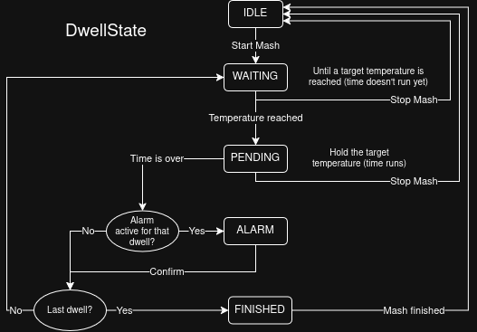

# brewery_heating_control
A brewery which consist of 3 pots (mash, fill, cook) should be analog heat controlled.

The temperature data is delivered by a digital sensor (DS18B20) which sends the values to an Arduino Mega 2560 Rev3.
It ist connected to a Raspberry Pi 4 via RX/TX seperated with an isolator. This component does the calculating and 
sends the needed heating values back to the Arduino. The Arduino then controls the induction heating plates with 3 Bits.

These heating plates are HENDI Modell 3500 M with electic power values from 500W to 3500W in 100W steps.
They have self built in circuit boards which can decide if the plate should be controlled by the Arduino, 
if the plate should be on/off and with how much electric power the indution plates should heat.
## Process info
- Time is internal handled in seconds (bcs the system is really slow) but interpolated for better UX
    - All inputs from the UI are handled with signals so it doesn't lag (up to one second).
- `DriverSerial` and `DriverSimulation` du a very similar thing to the programm. They get the heating power values and give back the current temperature.
### Enums:
#### `PotType`:
| Value | Pot |
| --- | --- |
| 0 | Mash |
| 1 | Fill |
| 2 | Cook | 
#### `DwellState`:
Finite State Machine that determines the State of the DwellController
<table>
 <tr>
  <td></td>
 </tr>
</table>

### `run_state`:
| Value | Meaning | Color |
| --- | --- | --- |
| 0 | pause/ stopped | gray |
| 1 | wait for heating | yellow |
| 2 | timer runs | green | 
| 3 | timer finished | red |

## Get Started
### Branch Info
The `main` branch is the one that holds the current state of the brewery. **Every** change has to got through a seperate branch and pull request.

### Installation
- To change the `.ui` use [Qt Creator 13.0.2](https://download.qt.io/official_releases/qtcreator/13.0/13.0.2/). 
    *This project requires Qt Creator 13.0.2 to maintain compatibility with the Qt 5-based UI files used by the project. The generated Python code is compiled with `pyuic5` for PyQt5, which requires Qt 5-compatible `.ui` files.*
- `pip install -r requirements.txt`

##### Create interface.py
``` bash
pyuic5 -x interface.ui -o interface.py
# -d for logs
```

### Possibly occuring errors
```
opening serial port: [Errno 13] could not open port /dev/ttyS0: [Errno 13] Permission denied: '/dev/ttyS0'
```
- Raspberry Pi couldn't connect to the Arduino
- **Possible problem:** Arduino is not connected with USB-cable

---
## Project History

This project has been in development since 2022.  
Prior to understanding version control with GitHub, versioning was managed using dated folders.  
The first version uploaded to GitHub was created on 11th March 2024.
